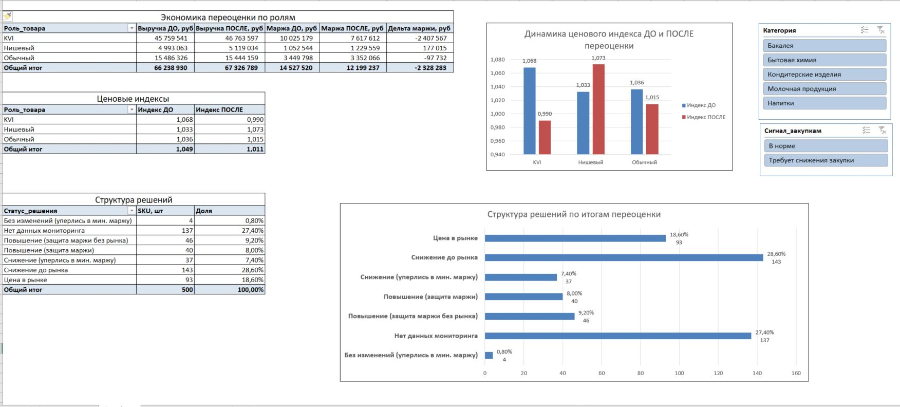

# Автоматизация регулярной переоценки и анализа конкурентов в ритейле

Прототип аналитического пайплайна (Python + Excel) для автоматизации ценообразования в продуктовом гипермаркете на основе ролевой модели ассортимента (`KVI`, `Обычный`, `Нишевый`) и мониторинга цен конкурентов.

## Бизнес-задача
В крупном ритейле регулярная переоценка тысяч SKU вручную приводит к двум рискам: потере ценового имиджа на товарах-индикаторах (`KVI`) или падению маржинальности ниже допустимых порогов при колебаниях закупочных цен. 

**Цель проекта:** разработать автоматизированный алгоритм расчета регулярных цен с учетом ценовой политики сети, очисткой входящих данных мониторинга и оценкой экономического эффекта.

## Этапы реализации (Pipeline)
1. **Моделирование данных (`Python` / `pandas`, `numpy`):** сгенерирован синтетический датасет на 500 SKU и 916 наблюдений по 4 федеральным сетям с учетом реальных дефектов входящих выгрузок (дубликаты, устаревшие замеры, выбросы сопоставления фасовки) и разделением на регулярные и промо-цены.
2. **Очистка и валидация данных:** настроена воронка фильтрации аномалий (отсечено ~30% некорректных/устаревших записей), раздельно агрегированы регулярные и акционные цены конкурентов, оценено покрытие ассортимента.
3. **Алгоритм ценообразования и QA:**
   * Дифференцированный выбор базы сравнения (`min` рынка для `KVI`, `mean` — для остальных ролей).
   * Жесткий приоритет защиты минимальной наценки («пол» маржинальности) при любом изменении цены.
   * Ритейл-округление ценников (`.90` до 100 руб., `9.00` от 100 руб.) с автоматическим контролем отсутствия нарушений политики (`0` ошибок).
4. **Оценка экономики и BI-визуализация (`Excel`):** рассчитан прогноз спроса с учетом коэффициентов эластичности, сформированы сигналы для смежных подразделений и собран интерактивный дашборд.

## Ключевые результаты (на горизонте 1 недели)
* **Восстановление ценового имиджа (`KVI`):** средний ценовой индекс снижен с **1.070** до **0.990**. За счет высокой эластичности спроса прогнозируется рост выручки в сегменте на **+1.00 млн руб.** (с 45.76 до 46.76 млн руб.) при плановой инвестиции **2.41 млн руб.** маржи в трафик.
* **Рост оборота сети:** общая недельная выручка выросла с **66.24** до **67.33 млн руб.** (+1.64%) при сохранении здоровой валовой рентабельности (**18.1%**).
* **Оптимизация нишевого ассортимента:** корректировка заниженных наценок на неэластичных товарах принесла **+177.0 тыс. руб.** дополнительной маржи.
* **Кросс-функциональные сигналы для бизнеса:**
  * **69 SKU** переданы в отдел закупок для переговоров с поставщиками (регулярные цены конкурентов ниже нашей минимальной маржи).
  * **114 SKU** переданы в промо-отдел для планирования ответных акций без снижения базовой регулярной цены.
  * **87 брендовых SKU** (из 137 позиций без мониторинга, за исключением уникальных нишевых товаров и СТМ) направлены на проверку матчинга.

## Управленческий дашборд (Excel)
Интерактивный отчет с динамикой ценовых индексов, экономикой по ролям и срезами по категориям:

## Стек технологий
* **Python:** `pandas`, `numpy`, `openpyxl` (очистка данных, алгоритмическая переоценка, QA-тесты).
* **MS Excel:** сводные таблицы, условное форматирование, срезы, динамические диаграммы.
